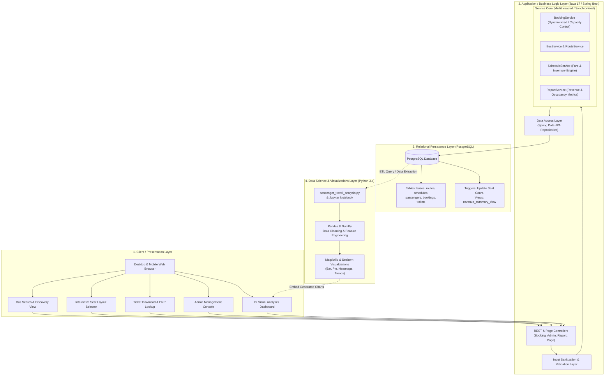
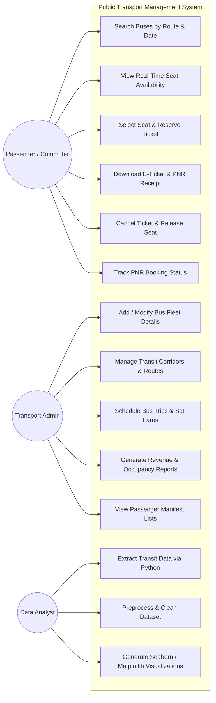
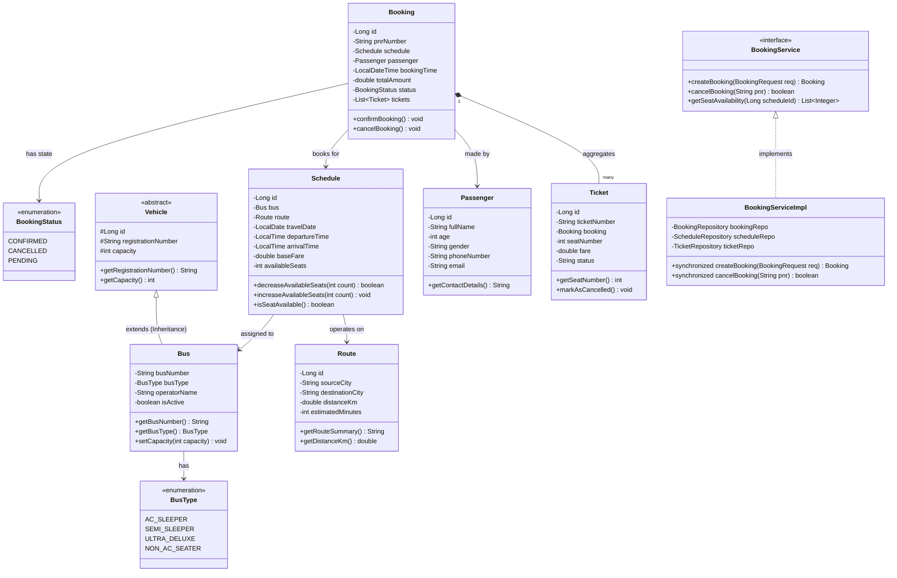
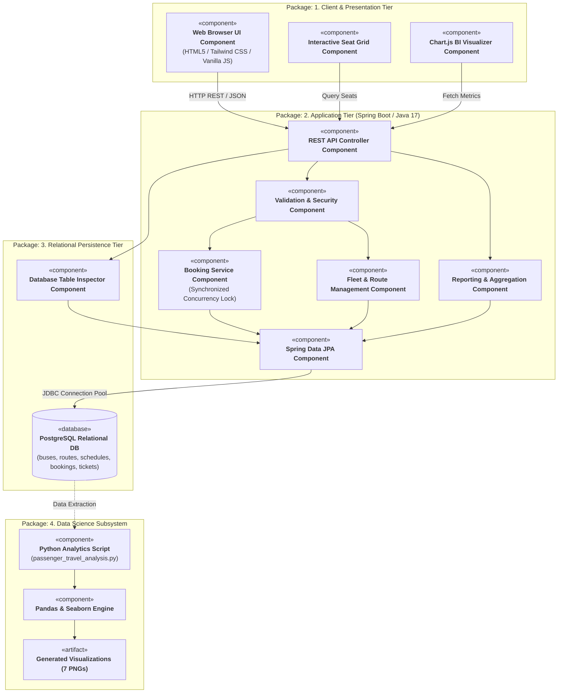
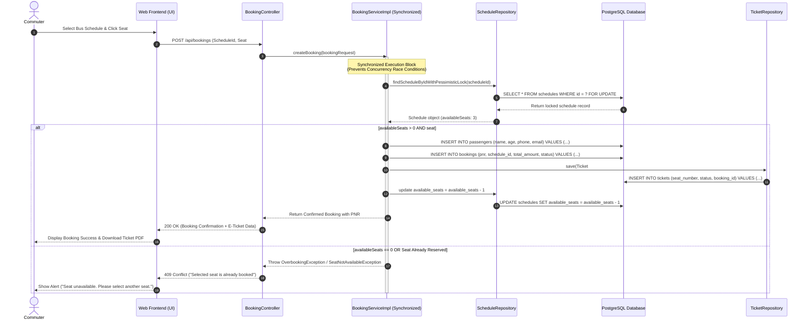
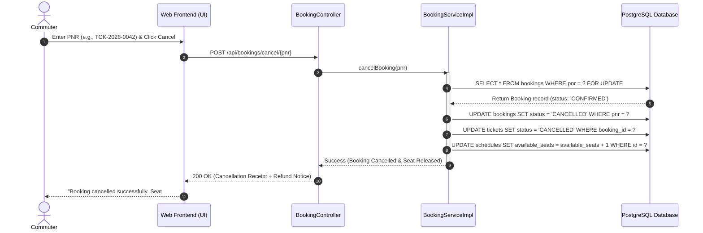
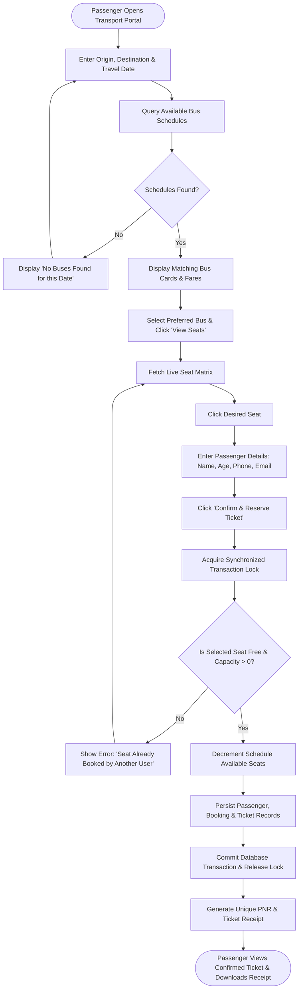

# SYSTEM DESIGN AND ARCHITECTURAL DIAGRAMS
## Public Transport Management and Passenger Travel Analysis System

---

### **ACADEMIC ASSESSMENT DETAILS**
- **Institution:** Velalar College of Engineering and Technology (Autonomous), Erode – 638012
- **Department:** Department of Information Technology
- **Course Title & Code:** Software Engineering (25ITT33)
- **Student Name:** Jeffrin
- **Register Number:** 732925ITR040
- **Class:** 25IT3A
- **Scenario:** Scenario 10 – Public Transport Management and Passenger Travel Analysis System

---

## 1. SYSTEM ARCHITECTURE DIAGRAM

The overall system architecture follows a modern **Multi-Tiered Layered Architecture** with distinct presentation, business service, data persistence, and data science analytical layers.

---

## 2. USE CASE DIAGRAM

The Use Case Diagram defines the primary actors (**Passenger / Commuter**, **Transport Administrator**, and **Data Analyst**) and their operational interactions with the system.

---

## 3. CLASS DIAGRAM

The Class Diagram illustrates the object-oriented structure implemented in the Java backend (Unit 1 to Unit 5 of the Java Programming syllabus), showcasing classes, attributes, methods, relationships, and inheritance.

---

## 4. COMPONENT DIAGRAM

The UML Component Diagram describes the organization and wiring of the physical components across the presentation, application, data, and analytics subsystems.

---

## 5. SEQUENCE DIAGRAM: TICKET BOOKING & OVERBOOKING PREVENTION

This sequence diagram depicts the **multithreaded synchronized transaction** workflow when a passenger books a ticket, highlighting race-condition prevention and atomic seat decrement.

---

## 6. SEQUENCE DIAGRAM: TICKET CANCELLATION & SEAT RELEASE

---

## 7. ACTIVITY DIAGRAM: END-TO-END PASSENGER BOOKING WORKFLOW

