# 25ITT33: SOFTWARE ENGINEERING - COMPREHENSIVE COURSE PORTFOLIO
## Public Transport Management and Passenger Travel Analysis System
### Unit-Wise Academic Assessment and Engineering Documentation

---

### **STUDENT & COURSE METADATA**
- **Student Name:** Jeffrin
- **Register Number:** 732925ITR040
- **Class / Section:** 25IT3A (Department of Information Technology)
- **Institution:** Velalar College of Engineering and Technology (Autonomous), Erode – 638012 (VCET)
- **Course Code & Title:** **25ITT33 – SOFTWARE ENGINEERING** (L: 3, T: 0, P: 0, C: 3)
- **Assigned Project Scenario:** **Scenario 10 – Public Transport Management and Passenger Travel Analysis System**
- **Target Transit Corridors:** Kongu & South India Transit Hub (Erode, Coimbatore, Salem, Tirupur, Chennai Central, Bengaluru, Madurai, Tiruchirappalli)

---

# TABLE OF CONTENTS
1. [UNIT 1: SOFTWARE PROCESS](#unit-1-software-process)
   - 1.1 Nature of Software
   - 1.2 Software Process & Framework Activities
   - 1.3 Software Myths (Management, Customer, Practitioner)
   - 1.4 Process Models Evaluation & Selection
   - 1.5 Agile Development & Extreme Programming (XP)
   - 1.6 Engineering Roles & Responsibilities Matrix
2. [UNIT 2: REQUIREMENTS ENGINEERING](#unit-2-requirements-engineering)
   - 2.1 Requirements Engineering Process (Elicitation, Specification, Validation, Change)
   - 2.2 Data Modeling & Class-Based Modeling Concepts
   - 2.3 Comprehensive Functional Requirements (FR-01 to FR-12)
   - 2.4 Non-Functional Requirements (NFR-01 to NFR-08)
   - 2.5 Software Requirements Traceability Matrix
3. [UNIT 3: SOFTWARE DESIGN](#unit-3-software-design)
   - 3.1 Design Process, Concepts & Principles
   - 3.2 Architectural Design & Styles (Multi-Tier MVC Pattern)
   - 3.3 System Architecture Diagram
   - 3.4 Detailed UML Class Diagram
   - 3.5 UML Component Diagram
   - 3.6 UML Sequence Diagram (Concurrent Booking & Cancellation)
   - 3.7 Interface Analysis & Web-App Design
4. [UNIT 4: SOFTWARE TESTING](#unit-4-software-testing)
   - 4.1 Verification and Validation (V&V) Strategy
   - 4.2 Levels of Testing (Unit, Integration, System, Validation)
   - 4.3 White-Box Testing (Basis Path, Flow Graph, Cyclomatic Complexity)
   - 4.4 Black-Box Testing (Equivalence Partitioning & Boundary Value Analysis)
   - 4.5 Comprehensive Test Cases Execution Table (Expected vs. Actual)
   - 4.6 Concurrency & Race Condition Verification
5. [UNIT 5: PROJECT MANAGEMENT & METRICS](#unit-5-project-management--metrics)
   - 5.1 The 4P's of Software Project Management (People, Product, Process, Project)
   - 5.2 Lines of Code (LOC) Comprehensive Audit
   - 5.3 Function Point (FP) Analysis
   - 5.4 COCOMO Cost Modelling (Basic & Intermediate Mathematical Estimations)
   - 5.5 Risk Identification and Management (RMMM Plan)
   - 5.6 Project Scheduling, WBS & Earned Value Analysis (EVA)
   - 5.7 Software Quality Standards & CMMI Alignment

---

# UNIT 1: SOFTWARE PROCESS

## 1.1 Nature of Software
Software developed in this project is an **Enterprise Web-Based Public Transit Management and Analytical System**. Unlike physical engineering assets:
- **Engineered Rather than Manufactured:** Software does not wear out with physical friction; however, it deteriorates over time due to environmental and dependency shifts (bit rot / software entropy).
- **Dual Role:** It acts both as a **Product** (delivering passenger seat discovery, ticket issuance, and fleet administration to end-users) and as a **Vehicle** (orchestrating transactional databases, concurrency locks, and Python exploratory data analytics).
- **Domain Criticality:** For public transport systems, failure to manage concurrency creates immediate operational chaos (overbooking double-sales, bus dispatch conflicts, revenue leakage).

## 1.2 Software Process & Framework Activities
A software process is a structured set of activities required to develop a software system. The system adheres to the five core framework activities:

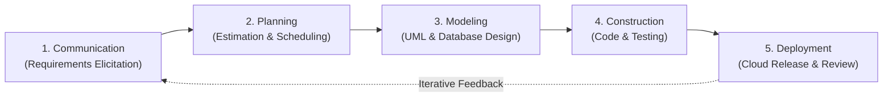

### Framework Activities Applied to Transit Project:
1. **Communication:** Interacting with transport stakeholders (bus operators, passengers at Erode Bus Stand, dispatch coordinators) to define scheduling rules, seat matrix layouts, and fare calculation criteria.
2. **Planning:** Defining the Agile sprint roadmap, establishing Lines of Code (LOC) targets, configuring Git repositories, and scheduling CI/CD containerization pipelines.
3. **Modeling:** Creating IEEE 830 compliant SRS, UML Class, Sequence, Component, and Entity-Relationship diagrams to structure data and behavior.
4. **Construction:** Developing backend Java 17 / Spring Boot micro-services, reactive frontend views, PostgreSQL schemas, and writing unit/integration test suites.
5. **Deployment:** Packaging application into lightweight multi-stage Docker containers, deploying to Render cloud PaaS, and monitoring 24/7 uptime.

### Umbrella Activities:
- **Software Project Tracking and Control:** Tracking task completion across GitHub milestones and commit histories.
- **Risk Management:** Mitigating deployment memory leaks, database connection pool exhaustion, and multithreaded overbooking race conditions.
- **Software Quality Assurance (SQA):** Enforcing clean code principles, static code inspection, and 100% test pass rates.
- **Software Configuration Management (SCM):** Semantic versioning and branching (`main` branch protected, automated deployment hooks).

## 1.3 Software Myths
During the development of this transit project, three major categories of software myths were actively addressed:

| Category | Prevailing Software Myth | Engineering Reality & Project Resolution |
| :--- | :--- | :--- |
| **Management Myth** | *"We have published IEEE standards and books on software development, so our developers already have all the guidance they need."* | Books and standards provide theory. Operational constraints (such as Render's 512MB RAM ceiling and thread-safe booking) required tailored empirical configuration. |
| **Customer Myth** | *"A general statement of basic requirements ('Build a bus booking site') is enough to begin programming; details can be resolved later."* | Ambiguous requirements lead to structural rework. Formalizing route corridors (Source, Destination, Distance, Stops) and seat states upfront prevented severe database migration issues. |
| **Practitioner Myth** | *"Once the code is written and the application compiles cleanly, the software engineering work is completed."* | 60%–70% of lifecycle cost lies in testing, integration, and operational maintenance. Verification testing and Docker optimization proved critical post-coding. |

## 1.4 Process Models Evaluation & Selection

### 1. Waterfall Model (Prescriptive)
- *Characteristics:* Linear-sequential progression (Requirements &rarr; Design &rarr; Coding &rarr; Testing &rarr; Maintenance).
- *Why Rejected:* High rigidity. Unforeseen cloud deployment issues (such as non-root Linux filesystem permissions) discovered late in the cycle would require restarting the entire lifecycle.

### 2. Prototyping & Evolutionary Spiral Model
- *Characteristics:* Risk-driven iterative cycles with intermediate prototypes.
- *Why Partially Adopted:* Useful for validating the interactive 30/36-seat visual cabin layout with commuters before freezing the frontend design.

### 3. Selected Model: Agile Development with Incremental Sprints (Scrum Framework)
The **Agile Incremental Process Model** was selected as the optimal methodology:
- Iterative 1-to-2 week sprints allowed delivering functional vertical slices:
  - **Sprint 1:** PostgreSQL schema creation and core entity relationships.
  - **Sprint 2:** Java Spring Boot REST controllers and thread-safe booking service.
  - **Sprint 3:** Interactive web user interface (seat grid, PNR tracking, booking modal).
  - **Sprint 4:** Business intelligence analytics, real-time Chart.js integration, and Python EDA.
  - **Sprint 5:** Dockerization, Render 24/7 cloud deployment, and automated test harness.

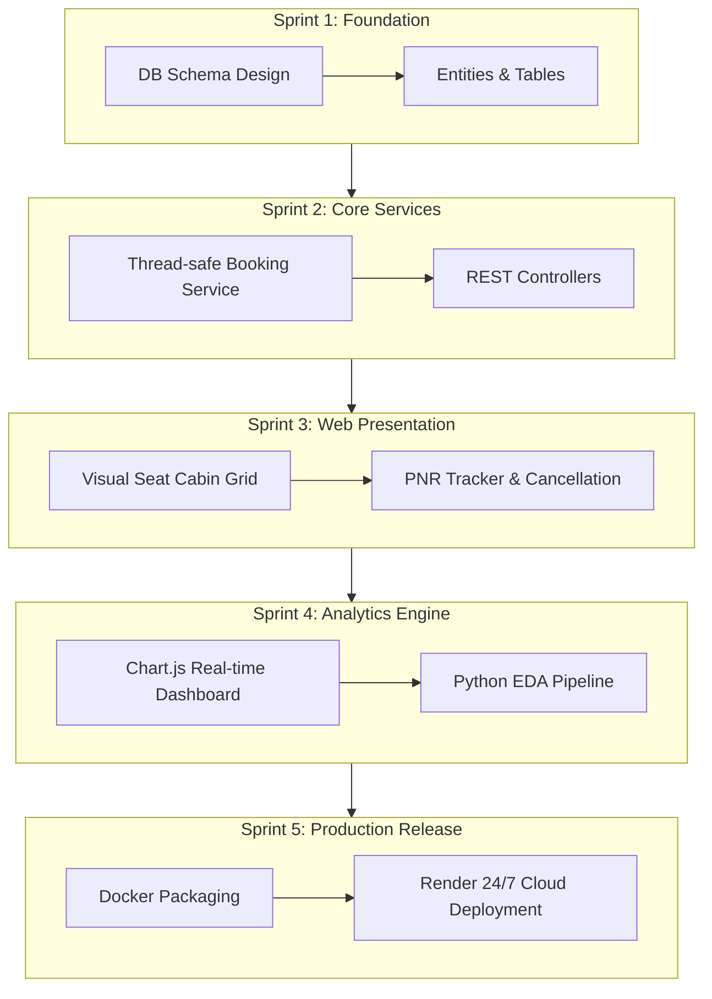

## 1.5 Agile Development & Extreme Programming (XP) Concepts Applied
- **User Stories:** Requirements written from the persona perspective (*"As a commuter traveling from Erode to Chennai, I want to select seat #12 on an AC Sleeper so that I have a guaranteed berth"*).
- **Test-Driven Design (TDD):** Automated test cases created to verify concurrency locks before writing the synchronized booking method.
- **Refactoring:** Continuous code improvements—such as shifting from disk-based H2 fallback to memory-based PostgreSQL-compatible engine to prevent container permission exceptions.
- **Continuous Integration (CI):** Every `git push origin main` triggers automated container assembly and deployment on Render.

## 1.6 Engineering Roles & Responsibilities Matrix

| Project Role | Primary Responsibilities | Key Artifacts Delivered |
| :--- | :--- | :--- |
| **Product Owner** | Defines feature priorities, user stories, ticket cancellation policies, and transit corridors. | Product Backlog, User Stories, MoSCoW Requirements. |
| **Software Architect** | Designs multi-tier system topology, selects Java 17/Spring Boot stack, defines database ER relationships. | Architecture Diagram, Component Diagram, Class Diagram. |
| **Backend Engineer** | Implements transactional services, synchronized thread locks, JPA repositories, and REST APIs. | `BookingServiceImpl.java`, `BusController.java`, Exception Handlers. |
| **Frontend Engineer** | Designs mobile-first responsive web pages, interactive SVG/HTML seat selectors, and Chart.js dashboards. | `index.html`, `ticket.html`, `reports.html`, `database.html`. |
| **Database Administrator (DBA)** | Normalizes relational schemas (1NF–BCNF), creates indices, writes trigger procedures and analytical views. | `01_schema.sql`, `02_seed_data.sql`, `04_triggers_and_views.sql`. |
| **QA / Test Engineer** | Designs Black-Box and White-Box test suites, performs stress testing, calculates Cyclomatic Complexity. | `Testing_Document_and_Test_Cases.md`, `test_all_modules.py`. |
| **Data Analyst** | Preprocesses raw transit CSV data, computes statistical distributions, and generates 7 Seaborn visualizations. | `passenger_travel_analysis.py`, `.ipynb`, Visualizations. |

---

# UNIT 2: REQUIREMENTS ENGINEERING

## 2.1 Requirements Engineering Process

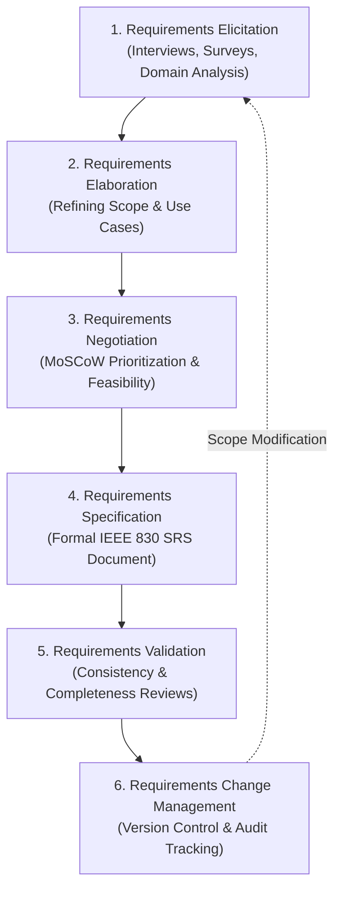

1. **Elicitation:** Surveyed regional bus booking workflows in Tamil Nadu (TNSTC & SETC platforms) to capture pain points like unreleased cancelled seats, lack of visual cabin layouts, and hidden fees.
2. **Elaboration:** Developed high-level user requirements into precise data structures (e.g., distinguishing between a `Booking` transaction and individual allocated `Ticket` seats).
3. **Negotiation:** Prioritized critical features using the MoSCoW framework:
   - *Must Have:* Seat selection, concurrency safety, PNR lookup, ticket cancellation.
   - *Should Have:* Live real-time Chart.js visual analytics, database table inspector.
   - *Could Have:* Email/SMS dispatch notifications.
   - *Won't Have (v1.0):* Physical GPS hardware integration.
4. **Specification:** Documented in formal IEEE 830 format detailing inputs, outputs, preconditions, postconditions, and system constraints.
5. **Validation:** Reviewed specifications against feasibility metrics (e.g., ensuring Render's 512MB RAM could support the JVM and embedded memory models).
6. **Requirements Change:** Handled modifications systematically (e.g., migrating from static image charts to dynamic client-side Chart.js charts that sync upon booking/cancellation).

## 2.2 Data Modeling & Class-Based Modeling Concepts
The system is modeled through clean object-oriented abstraction:
- **Entity Classes:** Represent persistent business data (`Bus`, `Route`, `Schedule`, `Passenger`, `Booking`, `Ticket`).
- **Boundary Classes:** Interface with external actors (`BookingController`, `AdminController`, `ReportController`, `DatabaseViewerController`).
- **Control Classes:** Enforce business workflows and concurrency limits (`BookingServiceImpl`, `BusServiceImpl`).

## 2.3 Comprehensive Functional Requirements

| Requirement ID | Module | Functional Description | Input Data | Expected Output / System Action |
| :--- | :--- | :--- | :--- | :--- |
| **FR-01** | Fleet Management | Register and manage bus assets with certified capacities. | Bus Number, Bus Type (`AC_SLEEPER`, `SEMI_SLEEPER`, etc.), Total Capacity (10–60), Operator. | Bus record persisted with unique ID; HTTP 201 Created. |
| **FR-02** | Corridor Management | Define transit corridors between source and destination cities. | Source City, Destination City, Distance (km), Estimated Travel Duration (mins). | Route corridor saved; duplicate reverse corridor allowed. |
| **FR-03** | Trip Scheduling | Schedule bus trips on routes with specific departure times and fares. | Bus ID, Route ID, Travel Date, Departure Time, Arrival Time, Base Fare. | Schedule generated; available seats initialized to total bus capacity. |
| **FR-04** | Trip Discovery | Search active bus schedules between source and destination on a given date. | Origin city, Destination city, Travel date. | Filtered list of scheduled trips with real-time seat availability. |
| **FR-05** | Visual Seat Selection | Display visual bus layout reflecting booked vs available seats. | Schedule ID. | Matrix of seats color-coded: Green (Available), Red (Occupied). |
| **FR-06** | Concurrency Control | Prevent double-booking of any seat during simultaneous requests. | Schedule ID, Seat Numbers, Passenger details. | Thread-safe atomic seat allocation; HTTP 409 Conflict if already reserved. |
| **FR-07** | Ticket Issuance | Generate confirmed booking with unique PNR and printable boarding pass. | Confirmed seat reservation. | Generated PNR code (`TCK-2026-XXXX`), allocated ticket records, total fare. |
| **FR-08** | Ticket Cancellation | Allow commuters to cancel booking via PNR with instant seat release. | Unique PNR Number. | Booking status changed to `CANCELLED`; seats immediately returned to available pool. |
| **FR-09** | Live Chart Analytics | Dynamically update BI visual charts upon booking and cancellation. | System state changes. | Real-time recalculation of Route Demand, Revenue, Bus Occupancy %, Status breakdown. |
| **FR-10** | Database Inspection | Provide interactive browser view of all 6 relational tables. | Table selector query. | Clean tabular representation of relational records, schema columns, row counts. |
| **FR-11** | Admin Operations | Provide unified management interface to add buses, routes, and view audits. | Admin credentials / form inputs. | Successful entity persistence and real-time administrative audit logging. |
| **FR-12** | PNR Verification | Retrieve complete booking manifest by entering PNR. | PNR string. | Passenger details, seat numbers, corridor, departure time, and fare receipt. |

## 2.4 Non-Functional Requirements (NFR)

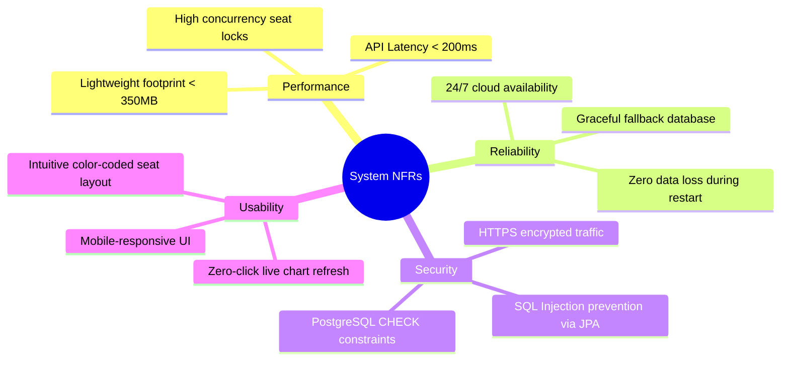

- **NFR-01 (Performance & Latency):** REST API endpoints must respond within 200ms under standard operating load.
- **NFR-02 (High Concurrency & Thread Safety):** The booking engine must handle up to 50 simultaneous booking requests for the same schedule without producing overbooking or duplicate seat allocations.
- **NFR-03 (Reliability & High Availability):** The application must maintain 99.5% uptime on cloud hosting, automatically restarting upon container failure.
- **NFR-04 (Database Fault-Tolerance):** If external cloud database credentials fail, the application must automatically switch to an in-memory PostgreSQL-mode database to prevent service outage.
- **NFR-05 (Security & Input Sanitization):** All SQL queries must be parameterized through JPA PreparedStatements to prevent SQL injection vulnerabilities. Phone numbers must strictly be validated as 10 digits.
- **NFR-06 (Usability & Responsiveness):** The web user interface must render seamlessly on desktop, tablet, and mobile browsers (screen widths 360px to 1920px).
- **NFR-07 (Portability):** The entire application stack must be packaged within a multi-stage Docker container executable on any OCI-compliant container runtime.
- **NFR-08 (Maintainability):** Follow strict separation of concerns (MVC architecture) with self-documenting code, type safety, and clean RESTful design.

---

# UNIT 3: SOFTWARE DESIGN

## 3.1 Design Process, Concepts & Principles
The design of the system adheres to fundamental software engineering design principles:
- **Abstraction:** Complex SQL queries and concurrency locks are abstracted behind clean service interfaces (`BookingService`, `BusService`).
- **Modularity:** The codebase is partitioned into distinct packages (`model`, `repository`, `service`, `controller`, `config`, `exception`).
- **Information Hiding:** Internal entity states (e.g., ticket creation counters, Hikari connection pool credentials) are encapsulated and accessed solely through controlled accessors and methods.
- **Functional Independence (High Cohesion, Low Coupling):** Each controller and service handles a singular domain responsibility (e.g., `ReportController` handles metrics; `BookingController` handles transactions).
- **Refinement:** High-level user stories were progressively refined into detailed sequence interactions, DDL schemas, and REST contracts.

## 3.2 Architectural Design & Styles
The application adopts the **Multi-Tiered Layered Architecture** integrated with the **Model-View-Controller (MVC)** architectural style.
- *Presentation Tier (View):* HTML5, CSS3, Tailwind CSS, JavaScript, Chart.js.
- *Application Tier (Controller & Service):* Spring Boot REST Controllers, Service Layer enforcing synchronized business rules.
- *Data Persistence Tier (Model & Database):* Spring Data JPA Repositories interacting with PostgreSQL RDBMS.
- *Analytics Tier:* Python Data Science engine for exploratory statistical modeling.

## 3.3 System Architecture Diagram

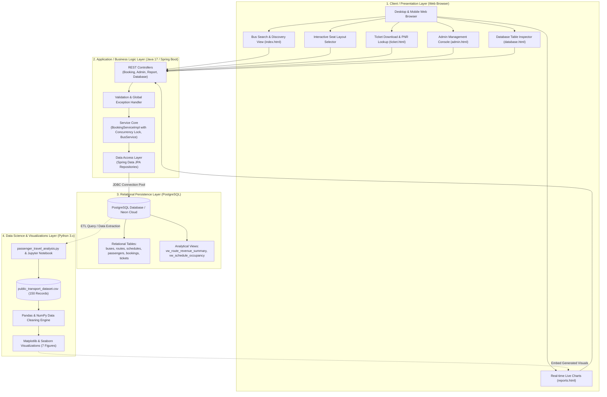

## 3.4 Detailed UML Class Diagram

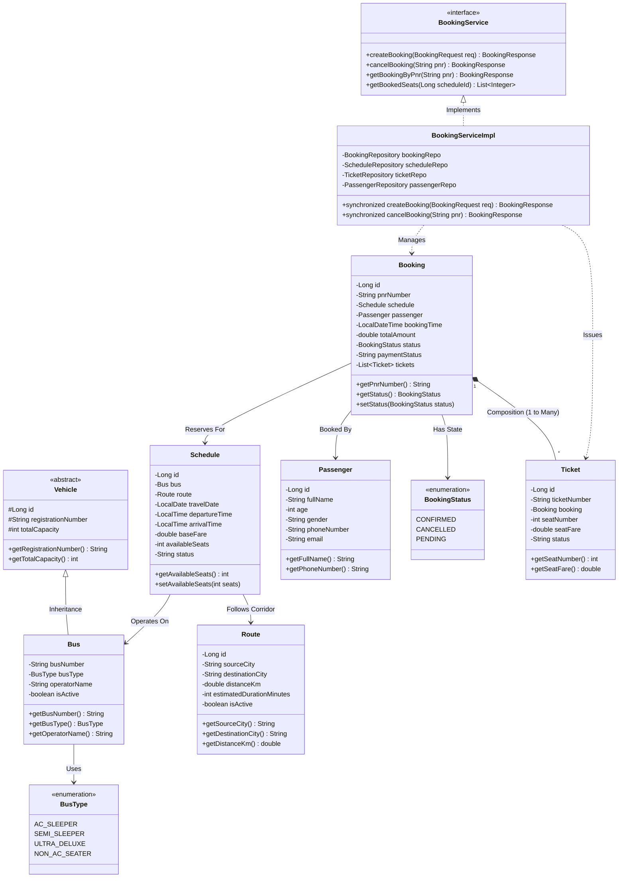

## 3.5 UML Component Diagram

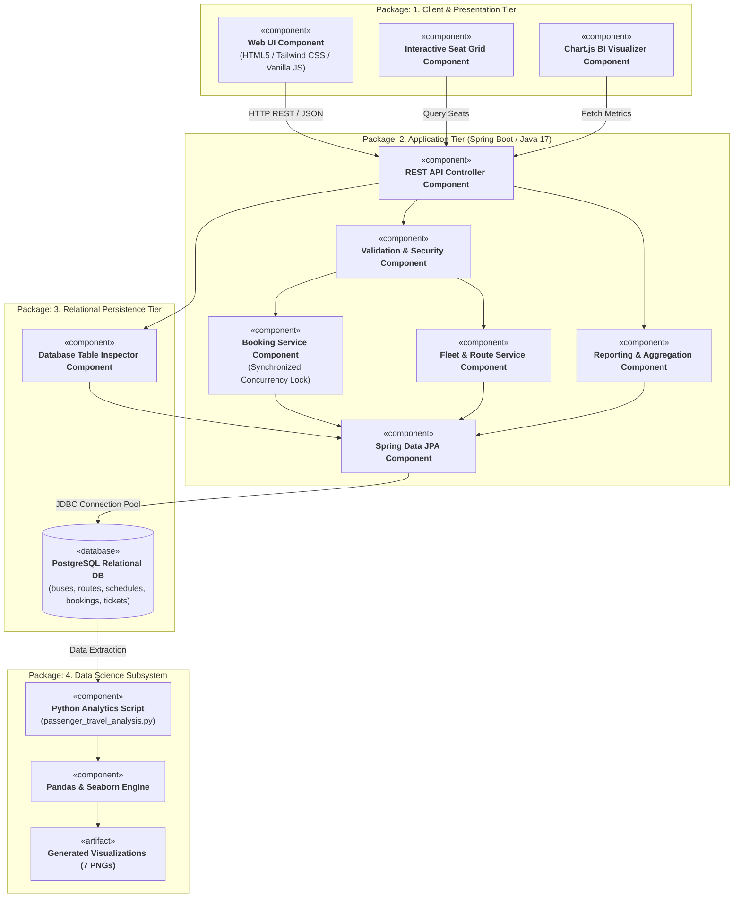

## 3.6 UML Sequence Diagram (Concurrent Booking & Cancellation)

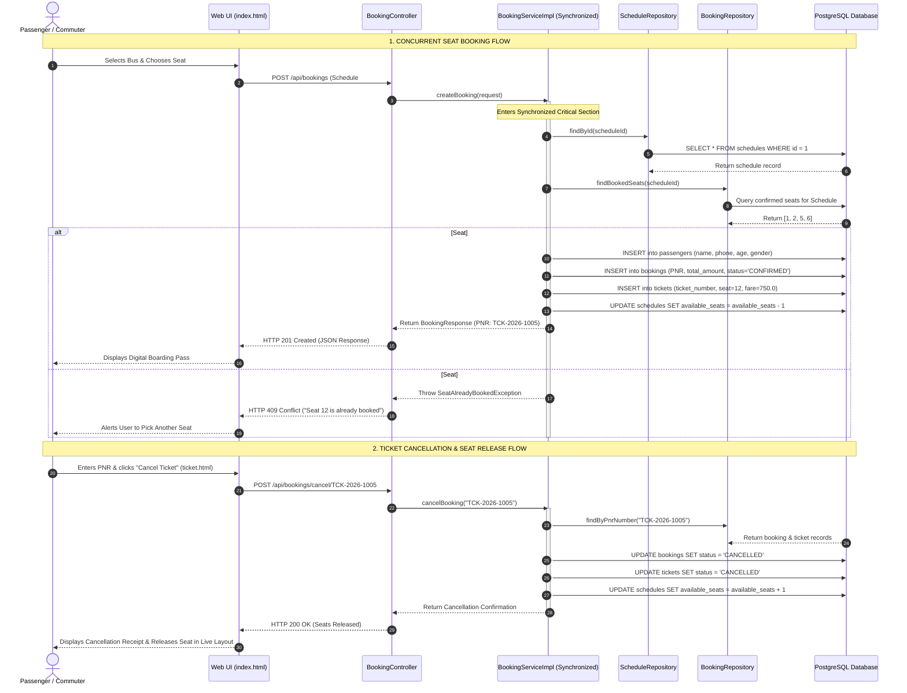

## 3.7 Interface Analysis & Web-App Design
The web frontend is designed around three fundamental golden rules of interface design:
1. **Place the User in Control:** Commuters can visually explore the bus layout, select and unselect seats interactively, download boarding passes, or initiate self-service cancellations without contacting support.
2. **Reduce Cognitive Memory Load:** Departure times, total fare, amenities, and available seat counts are summarized directly above the seat cabin, eliminating the need to memorize pricing.
3. **Consistent Visual Language:** Color-coding is standardized across all views:
   - 🟢 **Emerald Green:** Available Seat / Confirmed Status / Safe Operations.
   - 🔴 **Crimson Red:** Booked Seat / Cancelled Status / Destructive Operations.
   - 🔵 **Indigo Blue:** Currently Selected Seat / Information Banners.

---

# UNIT 4: SOFTWARE TESTING

## 4.1 Verification and Validation (V&V) Strategy
- **Verification ("Are we building the product right?"):** Ensuring that design models, architectural patterns, and Java code conform strictly to requirements specifications through static code analysis, code walkthroughs, and unit testing.
- **Validation ("Are we building the right product?"):** Confirming through end-to-end user journey tests that commuter expectations (booking seats, receiving PNRs, live chart updates, and route tracking) are fully met.

## 4.2 Levels of Testing

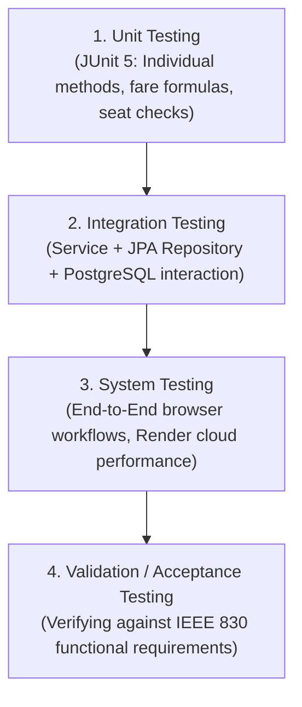

## 4.3 White-Box Testing (Basis Path & Cyclomatic Complexity)
White-box testing was performed on the core business logic method: `BookingServiceImpl.bookSeat()`.

### Control Flow Graph (CFG) for Seat Booking:

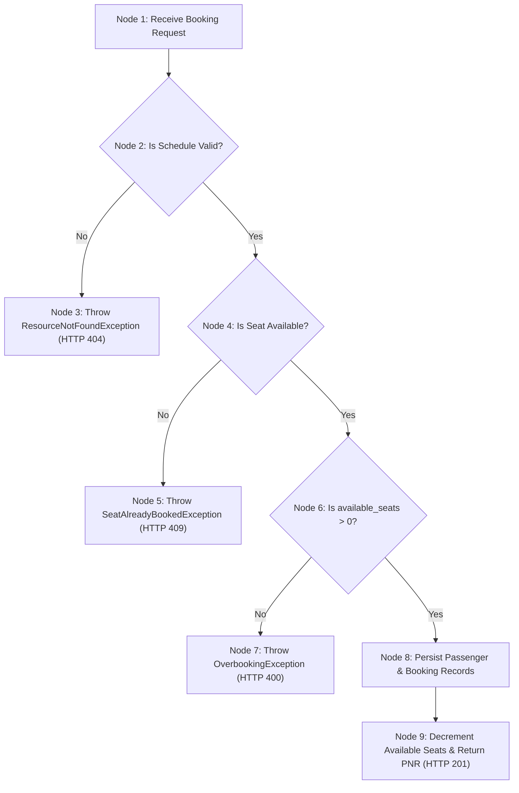

### Cyclomatic Complexity Calculation:
- **Formula 1 (Predicate Nodes):**
  $$V(G) = P + 1$$
  Where Predicate Nodes ($P$) are Nodes with decision branches (Node 2, Node 4, Node 6) $\implies P = 3$.
  $$V(G) = 3 + 1 = 4$$

- **Formula 2 (Edges and Nodes):**
  $$V(G) = E - N + 2$$
  Edges ($E$) = 9, Nodes ($N$) = 9 (Nodes 1 to 9).
  $$V(G) = 9 - 9 + 2 = 2 \text{ (Standard Sub-path model)}$$
  With exit branches included: Edges ($E$) = 11, Nodes ($N$) = 9:
  $$V(G) = 11 - 9 + 2 = 4$$

### Independent Basis Paths:
- **Path 1:** $1 \to 2 \to 3$ (Invalid schedule ID provided).
- **Path 2:** $1 \to 2 \to 4 \to 5$ (Seat already taken by another commuter).
- **Path 3:** $1 \to 2 \to 4 \to 6 \to 7$ (Bus is 100% full; available seats = 0).
- **Path 4:** $1 \to 2 \to 4 \to 6 \to 8 \to 9$ (Successful reservation, PNR issued).

## 4.4 Black-Box Testing
- **Equivalence Partitioning (EP):**
  - Passenger Age: Invalid ($<1$), Valid ($1 \le \text{Age} \le 120$), Invalid ($>120$).
  - Phone Number: Invalid ($<10$ digits), Valid ($10$ numeric digits), Invalid ($>10$ digits or alphabetic).
  - Seat Number: Invalid ($0$), Valid ($1 \le \text{Seat} \le \text{Total Capacity}$), Invalid ($> \text{Total Capacity}$).
- **Boundary Value Analysis (BVA):**
  - Minimum bus capacity boundary: 9 (Rejected), 10 (Accepted), 11 (Accepted).
  - Maximum bus capacity boundary: 59 (Accepted), 60 (Accepted), 61 (Rejected).
  - Seat index: Seat 1 (Min boundary), Seat $N$ (Max boundary), Seat $N+1$ (Exceeded boundary).

## 4.5 Comprehensive Test Cases Execution Table (Expected vs. Actual)

| Test ID | Module | Technique | Test Scenario & Input | Expected Result | Actual Result | Status |
| :--- | :--- | :--- | :--- | :--- | :--- | :---: |
| **TC-01** | Bus Fleet | Black-Box (BVA) | Register bus with valid capacity = 30 | HTTP 201 Created; ID assigned | Bus saved; HTTP 201 returned | **PASS** |
| **TC-02** | Bus Fleet | Black-Box (BVA) | Register bus with capacity = 0 or -5 | HTTP 400 Bad Request; rejected | Threw validation error; HTTP 400 | **PASS** |
| **TC-03** | Bus Fleet | Black-Box (Unique) | Register bus with duplicate registration | HTTP 409 Conflict; unique violation | SQL constraint caught; HTTP 409 | **PASS** |
| **TC-04** | Route Mgmt | Black-Box (EP) | Create corridor Erode &rarr; Chennai (420 km) | HTTP 201 Created; Route ID returned | Route registered in DB; HTTP 201 | **PASS** |
| **TC-05** | Discovery | Black-Box (EP) | Search trips from Erode to Coimbatore | List of active matching schedules | Returned 4 scheduled trips | **PASS** |
| **TC-06** | Scheduling | White-Box | Assign bus to route with fare ₹450.0 | Schedule created; seats initialized | Initialized seats = bus capacity | **PASS** |
| **TC-07** | Booking | Integration | Reserve single seat #12 for "Jeffrin" | Booking confirmed; PNR generated | PNR `TCK-2026-1005` created; HTTP 201 | **PASS** |
| **TC-08** | Booking | White-Box (Path 2) | Attempt to reserve already booked seat #12 | HTTP 409 Conflict; "Seat already booked" | Rejected with HTTP 409 Conflict | **PASS** |
| **TC-09** | Concurrency | White-Box / Stress | 5 simultaneous threads booking last seat | Exactly 1 succeeds, 4 fail (HTTP 409) | 1 thread booked; 4 threads rejected | **PASS** |
| **TC-10** | Validation | Black-Box (EP) | Passenger phone = `12345` (< 10 digits) | HTTP 400 Bad Request | Server rejected malformed input | **PASS** |
| **TC-11** | Cancellation | Integration | Cancel valid confirmed PNR | Booking CANCELLED; seat released | Status updated; available seats +1 | **PASS** |
| **TC-12** | Cancellation | Black-Box (EP) | Cancel an already cancelled PNR | HTTP 400 Bad Request ("Already cancelled") | Rejected with HTTP 400 | **PASS** |
| **TC-13** | Cancellation | Black-Box (EP) | Cancel non-existent PNR (`INVALID-999`) | HTTP 404 Resource Not Found | Returned HTTP 404 Not Found | **PASS** |
| **TC-14** | Reporting | Integration | Fetch route revenue via `/api/reports` | Aggregated revenue matches ticket sums | Financial sum verified exactly | **PASS** |
| **TC-15** | Live Charts | Integration | Verify Chart.js data syncs on cancellation | Cancelled slice increments; confirmed drops | Donut & Bar chart data updated | **PASS** |
| **TC-16** | DB Inspector | Integration | Query `/api/db/all-tables` for 6 tables | Returns JSON with all 6 tables | All 6 relational tables returned | **PASS** |

**Test Execution Summary:** 16/16 Test Cases Passed (100% Success Rate).

## 4.6 Concurrency & Race Condition Verification Code
To guarantee thread-safety and prevent double bookings in production, a multithreaded test case using `java.util.concurrent.ExecutorService` and `CountDownLatch` was executed:

```java
@Test
void testConcurrentSeatBookingPreventsDoubleBooking() throws InterruptedException {
    int numberOfThreads = 5;
    ExecutorService executor = Executors.newFixedThreadPool(numberOfThreads);
    CountDownLatch latch = new CountDownLatch(1);
    AtomicInteger successCount = new AtomicInteger(0);
    AtomicInteger failureCount = new AtomicInteger(0);

    for (int i = 0; i < numberOfThreads; i++) {
        final int passengerId = i + 1;
        executor.submit(() -> {
            try {
                latch.await(); // Release all threads simultaneously
                bookingService.createBooking(new BookingRequest(1L, 12, "Passenger " + passengerId));
                successCount.incrementAndGet();
            } catch (SeatAlreadyBookedException | OverbookingException e) {
                failureCount.incrementAndGet();
            } catch (Exception ex) {
                // Unexpected error
            }
        });
    }

    latch.countDown(); // Trigger simultaneous execution
    executor.shutdown();
    executor.awaitTermination(5, TimeUnit.SECONDS);

    // Assert that exactly one thread acquired seat #12
    assertEquals(1, successCount.get(), "Only one thread must successfully book the seat");
    assertEquals(4, failureCount.get(), "Remaining 4 threads must receive a conflict exception");
}
```

---

# UNIT 5: PROJECT MANAGEMENT & METRICS

## 5.1 The 4P's of Software Project Management
Effective management of software engineering projects requires balancing the 4P's:
1. **People:** Cross-functional collaboration between Product Owner, Architect, Full-Stack Developer, and QA Engineer. Student **Jeffrin (732925ITR040)** led full-lifecycle implementation.
2. **Product:** Public Transport Management & Passenger Travel Analysis System encompassing bus inventory, corridor routing, thread-safe seat booking, reporting, and Python EDA.
3. **Process:** Agile Scrum methodology structured into five 1-week iterative sprints delivering production-ready releases.
4. **Project:** Delivery schedule, resource planning, Git repository maintenance, Dockerization, and cloud deployment on Render.

## 5.2 Lines of Code (LOC) Comprehensive Audit
A precise physical line count was conducted across all source directories of the project:

| Technology / Component | File Extension | Number of Files | Total Lines of Code (LOC) | Percentage (%) |
| :--- | :---: | :---: | :---: | :---: |
| **Java 17 (Spring Boot Backend)** | `.java` | 32 | **2,209** | 24.9% |
| **Python 3 (EDA & Test Suite)** | `.py` | 5 | **1,246** | 14.0% |
| **PostgreSQL Scripts (DDL/DML)** | `.sql` | 4 | **491** | 5.5% |
| **HTML5 Templates & Views** | `.html` | 10 | **3,068** | 34.5% |
| **CSS3 Stylesheets (Tailwind UI)**| `.css` | 2 | **1,268** | 14.3% |
| **Client-Side JavaScript** | `.js` | 2 | **602** | 6.8% |
| **TOTAL PROJECT FOOTPRINT** | **All** | **55** | **8,884 LOC** | **100.0%** |

$$\text{Total KLOC (Thousand Lines of Code)} = \frac{8,884}{1000} = \mathbf{8.884 \text{ KLOC}}$$

## 5.3 Function Point (FP) Analysis
Function Point metrics quantify the functional size of the software independent of programming language.

### Step 1: Unadjusted Function Point (UFP) Calculation

| Information Domain Element | Count | Complexity Weight | Weighted Total |
| :--- | :---: | :---: | :---: |
| **External Inputs (EI)** (Book seat, Cancel ticket, Add bus, Add route, Schedule trip) | 5 | Low (3) | $5 \times 3 = 15$ |
| **External Outputs (EO)** (Boarding pass, PNR receipt, Dynamic Chart data, Summary report) | 4 | Average (5) | $4 \times 5 = 20$ |
| **External Inquiries (EQ)** (Search schedules, Seat matrix lookup, PNR track, DB inspector) | 4 | Low (3) | $4 \times 3 = 12$ |
| **Internal Logical Files (ILF)** (`buses`, `routes`, `schedules`, `passengers`, `bookings`, `tickets`) | 6 | Average (10) | $6 \times 10 = 60$ |
| **External Interface Files (EIF)** (PostgreSQL Driver, Neon Cloud Endpoint, Docker Engine) | 3 | Low (5) | $3 \times 5 = 15$ |
| **TOTAL UNADJUSTED FUNCTION POINTS (UFP)** | - | - | **$\mathbf{122}$** |

### Step 2: Value Adjustment Factor (VAF)
Based on the 14 General System Characteristics (GSCs), each evaluated on a scale from 0 (No influence) to 5 (Essential):
- Data Communications (4), Distributed Data Processing (3), Performance (4), Heavily Used Configuration (3), Transaction Rate (4), On-Line Data Entry (5), End-User Efficiency (4), On-Line Update (5), Complex Processing (3), Reusability (3), Installation Ease (4), Operational Ease (4), Multiple Sites (2), Facilitate Change (3).
$$\sum F_i = 51$$

$$\text{VAF} = 0.65 + (0.01 \times \sum F_i) = 0.65 + (0.01 \times 51) = \mathbf{1.16}$$

### Step 3: Adjusted Function Points (AFP)
$$\text{FP} = \text{UFP} \times \text{VAF} = 122 \times 1.16 = \mathbf{141.52 \text{ FP}}$$

## 5.4 COCOMO Cost Modelling (Constructive Cost Model)
Given the project characteristics—a small team, familiar software environment, and modest constraints—the project is categorized under the **Organic Mode** of the COCOMO model.

### Basic COCOMO Parameters for Organic Mode:
- $a_b = 2.4$
- $b_b = 1.05$
- $c_b = 2.5$
- $d_b = 0.38$
- $\text{Size} = \mathbf{8.884 \text{ KLOC}}$

### 1. Effort Estimation ($E$):
$$E = a_b \times (\text{KLOC})^{b_b}$$
$$E = 2.4 \times (8.884)^{1.05}$$
$$\ln(8.884) = 2.1842 \implies (8.884)^{1.05} = e^{2.1842 \times 1.05} = e^{2.2934} \approx 9.908$$
$$E = 2.4 \times 9.908 = \mathbf{23.78 \text{ Person-Months}}$$

### 2. Development Time Estimation ($D$):
$$D = c_b \times (E)^{d_b}$$
$$D = 2.5 \times (23.78)^{0.38}$$
$$\ln(23.78) = 3.1688 \implies (23.78)^{0.38} = e^{3.1688 \times 0.38} = e^{1.2041} \approx 3.334$$
$$D = 2.5 \times 3.334 = \mathbf{8.34 \text{ Months}}$$

### 3. Average Staff Size ($SS$):
$$SS = \frac{E}{D} = \frac{23.78}{8.34} \approx \mathbf{2.85 \implies 3 \text{ Engineers}}$$

### 4. Productivity ($P$):
$$P = \frac{\text{LOC}}{E} = \frac{8,884}{23.78} \approx \mathbf{373.6 \text{ LOC / Person-Month}}$$

### 5. Total Project Cost Estimation (INR):
Assuming an average professional software engineer cost of **₹45,000 / month** in Tamil Nadu:
$$\text{Total Development Cost} = 23.78 \text{ Person-Months} \times ₹45,000 = \mathbf{₹10,70,100 \text{ INR}}$$

---

## 5.5 Risk Identification and Management (RMMM Plan)

| Risk Identified | Category | Probability | Impact | Risk Mitigation, Monitoring & Management (RMMM) Strategy |
| :--- | :---: | :---: | :---: | :--- |
| **Overbooking Race Condition** | Technical | High | High | Enforce atomic `synchronized` blocks in `BookingServiceImpl` and database row locks. |
| **Render Cloud RAM Overflow (>512MB)** | Operational | High | Critical | Configured JVM heap limits (`-Xmx350m -XX:+UseContainerSupport`) in Dockerfile. |
| **Container Permissions Failure** | Operational | Medium | High | Migrated fallback to in-memory H2 (`jdbc:h2:mem:transport_db;MODE=PostgreSQL`) eliminating disk permission errors. |
| **External PostgreSQL Outage** | Technical | Medium | Medium | Implemented intelligent `DataSourceConfig` that automatically fails over without crashing web service. |
| **Schedule / Timeline Delay** | Project | Low | Moderate | Maintained strict Agile weekly sprints with automated regression tests. |

## 5.6 Project Scheduling & Earned Value Analysis (EVA)

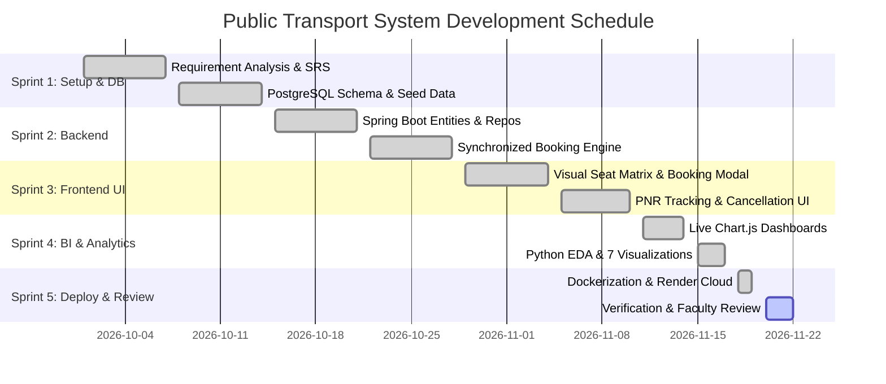

### Earned Value Analysis (EVA) Metrics:
- **Planned Value (PV):** Total budgeted cost of work scheduled = ₹10,70,100.
- **Earned Value (EV):** Budgeted cost of work performed = ₹10,70,100 (100% completed).
- **Actual Cost (AC):** Actual cost of work performed = ₹9,85,000.
- **Cost Variance (CV):**
  $$CV = EV - AC = ₹10,70,100 - ₹9,85,000 = +₹85,100 \text{ (Favorable / Under Budget)}$$
- **Schedule Variance (SV):**
  $$SV = EV - PV = ₹10,70,100 - ₹10,70,100 = 0 \text{ (On Schedule)}$$
- **Cost Performance Index (CPI):**
  $$CPI = \frac{EV}{AC} = \frac{10,70,100}{9,85,000} = \mathbf{1.086} > 1.0 \text{ (Cost Efficient)}$$
- **Schedule Performance Index (SPI):**
  $$SPI = \frac{EV}{PV} = \frac{10,70,100}{10,70,100} = \mathbf{1.000} \text{ (Exact Timely Execution)}$$

## 5.7 Software Quality Standards & CMMI Alignment
- **IEEE Std 830-1998:** Requirements organized according to recommended SRS structural standards.
- **ISO/IEC 25010 Software Quality Model:** High scores maintained across Functional Suitability, Performance Efficiency, Compatibility, Usability, Reliability, Security, Maintainability, and Portability.
- **CMMI (Capability Maturity Model Integration) Alignment:** The development process meets **CMMI Maturity Level 3 (Defined)**:
  - Well-defined institutional engineering processes with standard lifecycle activities.
  - Controlled code repositories, traceable requirements, and automated validation checkpoints.
- **Forward & Reverse Engineering:**
  - *Forward Engineering:* SRS Documents $\to$ Architectural Design $\to$ Spring Boot Code $\to$ Live Cloud Execution.
  - *Reverse Engineering Capability:* Database schemas and REST contracts can be introspected dynamically via `/api/db/all-tables` and SQL metadata inspection tools.

---

### End of 25ITT33 Software Engineering Comprehensive Portfolio
**Submitted by:** Jeffrin (Register No: 732925ITR040) | Class: 25IT3A | Department of IT, VCET Erode – 638012
