# ENTITY-RELATIONSHIP (ER) DIAGRAM AND RELATIONAL MODEL
## Public Transport Management and Passenger Travel Analysis System

---

### **ACADEMIC ASSESSMENT DETAILS**
- **Institution:** Velalar College of Engineering and Technology (Autonomous), Erode – 638012
- **Department:** Department of Information Technology
- **Course Title & Code:** Database Management Systems (25ITT31)
- **Student Name:** Jeffrin
- **Register Number:** 732925ITR040
- **Class:** 25IT3A
- **Scenario:** Scenario 10 – Public Transport Management and Passenger Travel Analysis System

---

## 1. ENTITY-RELATIONSHIP (ER) DIAGRAM

The ER diagram captures all entities, relationships, primary keys, attributes, and cardinality constraints adhering to relational database theory.

```mermaid
erDiagram
    BUS ||--o{ SCHEDULE : "assigned to (1:M)"
    ROUTE ||--o{ SCHEDULE : "operates on (1:M)"
    SCHEDULE ||--o{ BOOKING : "booked for (1:M)"
    PASSENGER ||--o{ BOOKING : "places (1:M)"
    BOOKING ||--|{ TICKET : "contains (1:M)"

    BUS {
        bigint bus_id PK
        varchar bus_number UK
        varchar bus_type "AC_SLEEPER, SEMI_SLEEPER, ULTRA_DELUXE, NON_AC_SEATER"
        int total_capacity
        varchar operator_name
        boolean is_active
        timestamp created_at
    }

    ROUTE {
        bigint route_id PK
        varchar source_city
        varchar destination_city
        decimal distance_km
        int estimated_duration_minutes
        boolean is_active
        timestamp created_at
    }

    SCHEDULE {
        bigint schedule_id PK
        bigint bus_id FK
        bigint route_id FK
        date travel_date
        time departure_time
        time arrival_time
        decimal base_fare
        int available_seats
        varchar status "SCHEDULED, COMPLETED, CANCELLED"
        timestamp created_at
    }

    PASSENGER {
        bigint passenger_id PK
        varchar full_name
        int age
        varchar gender "MALE, FEMALE, OTHER"
        varchar phone_number
        varchar email
        timestamp created_at
    }

    BOOKING {
        bigint booking_id PK
        varchar pnr_number UK
        bigint schedule_id FK
        bigint passenger_id FK
        timestamp booking_time
        decimal total_amount
        varchar status "CONFIRMED, CANCELLED"
        varchar payment_status "PAID, REFUNDED"
    }

    TICKET {
        bigint ticket_id PK
        varchar ticket_number UK
        bigint booking_id FK
        int seat_number
        decimal seat_fare
        varchar status "CONFIRMED, CANCELLED"
        timestamp created_at
    }
```

---

## 2. RELATIONAL MODEL / DATABASE SCHEMA

The formal relational schema notation showing primary keys (underlined with `[PK]`) and foreign keys with references `[FK -> Table(Column)]`:

1. **`buses`** (
   `bus_id` [PK], 
   `bus_number` [UNIQUE, NOT NULL], 
   `bus_type` [NOT NULL], 
   `total_capacity` [NOT NULL, CHECK (total_capacity > 0)], 
   `operator_name`, 
   `is_active`, 
   `created_at`
)

2. **`routes`** (
   `route_id` [PK], 
   `source_city` [NOT NULL], 
   `destination_city` [NOT NULL], 
   `distance_km` [NOT NULL, CHECK (distance_km > 0)], 
   `estimated_duration_minutes` [NOT NULL], 
   `is_active`, 
   `created_at`,
   UNIQUE (`source_city`, `destination_city`)
)

3. **`schedules`** (
   `schedule_id` [PK], 
   `bus_id` [FK -> `buses(bus_id)`], 
   `route_id` [FK -> `routes(route_id)`], 
   `travel_date` [NOT NULL], 
   `departure_time` [NOT NULL], 
   `arrival_time` [NOT NULL], 
   `base_fare` [NOT NULL, CHECK (base_fare > 0)], 
   `available_seats` [NOT NULL, CHECK (available_seats >= 0)], 
   `status` [NOT NULL], 
   `created_at`
)

4. **`passengers`** (
   `passenger_id` [PK], 
   `full_name` [NOT NULL], 
   `age` [NOT NULL, CHECK (age > 0 AND age <= 120)], 
   `gender` [NOT NULL], 
   `phone_number` [NOT NULL], 
   `email`, 
   `created_at`
)

5. **`bookings`** (
   `booking_id` [PK], 
   `pnr_number` [UNIQUE, NOT NULL], 
   `schedule_id` [FK -> `schedules(schedule_id)`], 
   `passenger_id` [FK -> `passengers(passenger_id)`], 
   `booking_time` [NOT NULL], 
   `total_amount` [NOT NULL, CHECK (total_amount >= 0)], 
   `status` [NOT NULL], 
   `payment_status` [NOT NULL]
)

6. **`tickets`** (
   `ticket_id` [PK], 
   `ticket_number` [UNIQUE, NOT NULL], 
   `booking_id` [FK -> `bookings(booking_id)` ON DELETE CASCADE], 
   `seat_number` [NOT NULL, CHECK (seat_number > 0)], 
   `seat_fare` [NOT NULL], 
   `status` [NOT NULL], 
   `created_at`,
   UNIQUE (`booking_id`, `seat_number`)
)

---

## 3. CARDINALITY AND PARTICIPATION CONSTRAINTS

| Relationship | Cardinality | Explanation |
| :--- | :--- | :--- |
| **Bus to Schedule** | 1 : N (One-to-Many) | A single bus can be assigned to multiple scheduled trips over different dates, but each schedule is operated by exactly one bus. Total participation on Schedule. |
| **Route to Schedule** | 1 : N (One-to-Many) | A transit route (e.g., Erode to Chennai) has multiple daily schedules. Each schedule belongs to exactly one route. |
| **Schedule to Booking** | 1 : N (One-to-Many) | A single bus schedule accommodates multiple passenger bookings up to its maximum capacity. |
| **Passenger to Booking** | 1 : N (One-to-Many) | A passenger can make multiple bookings over time. Each booking is placed under a primary passenger record. |
| **Booking to Ticket** | 1 : N (One-to-Many) | A single booking transaction can reserve one or more individual seats, creating a distinct ticket record for each reserved seat. |

---

## 4. INTEGRITY CONSTRAINTS AND BUSINESS RULES

1. **Domain Integrity:** Seat numbers, distances, ages, and capacities are constrained by SQL `CHECK` constraints to prevent negative or impossible values.
2. **Entity Integrity:** All primary keys (`bus_id`, `route_id`, `schedule_id`, etc.) are auto-incrementing surrogate keys with strict `NOT NULL` constraints.
3. **Referential Integrity:** Foreign keys link tables together. Deletion or updating of parent records enforces consistency (e.g., cascade or restrict constraints).
4. **Capacity Constraint:** The trigger `trg_prevent_overbooking` dynamically verifies that `available_seats` never drops below 0 when a booking is created.
